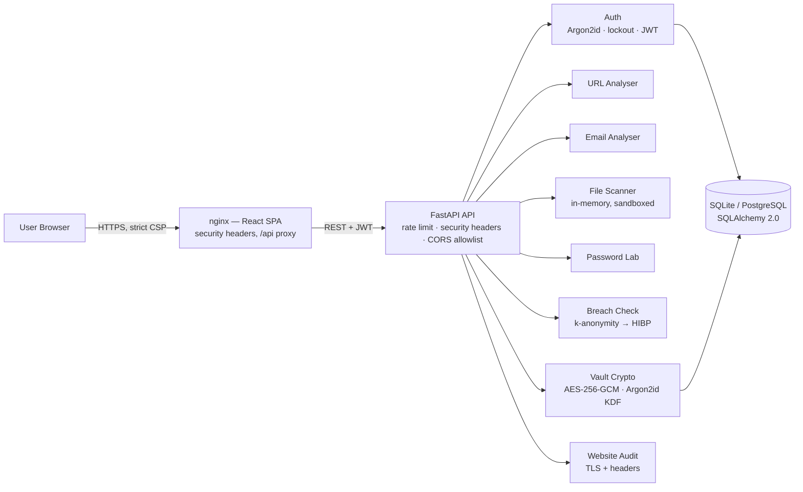

# 🛡️ Aegis — Personal Cyber Defense Platform

[](https://github.com/Manoj-2424150118/aegis-cyber-defense-platform/actions/workflows/ci.yml)
[](https://github.com/Manoj-2424150118/aegis-cyber-defense-platform/actions/workflows/codeql.yml)


[](https://aegis-cyber-defense-platform.onrender.com)

### ▶️ **Live demo: [aegis-cyber-defense-platform.onrender.com](https://aegis-cyber-defense-platform.onrender.com)** — no sign-up needed to check a link, email, file or password. *(Free-tier hosting: the first load after idle can take ~1 minute while the service wakes up.)*

> **One platform that protects an individual user against today's most common cyber threats** — phishing links, phishing/BEC email, malware attachments, weak and breached passwords, stolen secrets, and unsafe websites — built as a production-grade full-stack application with defence-in-depth applied to itself.

Built by [Manoj Kumar Sharma](https://github.com/Manoj-2424150118) — Cybersecurity & Software Professional (MCA, Manipal University Jaipur).

---

## 🚨 The problem

Most people don't get hacked by nation-state zero-days. They get hacked by:

1. A **phishing link** in an SMS or WhatsApp message
2. A **fake email** asking them to "verify" their account
3. A **malware attachment** disguised as an invoice (`invoice.pdf.exe`)
4. A **weak or reused password** that leaked in someone else's data breach
5. Storing PINs and recovery codes in **plaintext notes**
6. Typing card details into a **site with no real security controls**

Aegis gives a non-technical user one place to check each of these *before* it hurts them — and it practises what it preaches: the platform itself is hardened against the OWASP Top 10.

## ✨ The six protection modules

| # | Threat (real-world attack) | Module | What it detects / does |
|---|---|---|---|
| 1 | Phishing & fake login pages | **URL Analyser** | IP-literal hosts, punycode/homograph domains, typosquatting (edit-distance vs 22 brands incl. Indian banks & UPI), brand-in-host/path tricks, shorteners, `@` userinfo tricks, suspicious TLDs, DGA-like entropy, credential keywords — as explained, weighted findings |
| 2 | Phishing & Business Email Compromise | **Email Analyser** | SPF/DKIM/DMARC failures, Reply-To & Return-Path mismatches, display-name spoofing, freemail impersonation, urgency/pressure language, credential bait, link-text vs destination mismatch, and it re-scores every link with Module 1 |
| 3 | Malware & ransomware attachments | **File Scanner** | Magic-byte type spoofing, double extensions, dangerous types, Shannon entropy (packers), embedded droppers (PowerShell `-enc`, certutil, curl\|sh), macro auto-exec, base64-embedded PEs, zip bombs, executables hidden in archives. In-memory only — **files are never executed or written to disk** |
| 4 | Weak / reused passwords | **Password Lab** | Entropy & offline crack-time estimate, common-password detection, plus a **secure generator** (`secrets` module) and diceware-style passphrases |
| 5 | Credential stuffing after breaches | **Breach Check** | Have-I-Been-Pwned **k-anonymity** range API — only 5 hex chars of the SHA-1 hash ever leave the machine; offline fallback list when the network is down |
| 6 | Theft of stored secrets | **Encrypted Vault** | **AES-256-GCM** authenticated encryption, key derived from the user's master password with **Argon2id**. The server stores ciphertext only — a database leak reveals nothing. Tampering and wrong passwords are detected by the GCM tag |
| + | MITM & unsafe websites | **Website Audit** | Grades any site A–F on HTTPS/HSTS, CSP, X-Frame-Options, MIME-sniffing, Referrer/Permissions policy and cookie flags (Secure/HttpOnly/SameSite) |

## 🏗️ Architecture



Design principles: **pure, testable detection engines** (no I/O inside modules except the two documented network clients), thin routers, validated inputs everywhere, and configuration only from the environment.

## 🔐 How Aegis secures itself (OWASP Top 10)

| Risk | Control in this codebase |
|---|---|
| Broken access control | JWT auth on all vault routes; per-user row scoping on every query |
| Cryptographic failures | Argon2id password hashing, AES-256-GCM vault, short-lived access tokens, secrets from env only |
| Injection | SQLAlchemy parameterised queries; Pydantic validation of every request body |
| Insecure design | Account lockout (5 failures → 15 min), generic auth errors (no user enumeration) |
| Security misconfiguration | Strict security-headers middleware + nginx CSP, CORS allowlist, server banner removal |
| Vulnerable components | Dependabot (pip/npm/actions/docker), Bandit + CodeQL + npm audit in CI |
| Auth failures | Rate limiting (stricter on `/api/auth`), Argon2id, 12-char minimum passwords |
| SSRF | Website audit fetches only `http/https`, with timeouts and error containment |
| Logging/monitoring | Health endpoint, structured CI, scan history per user |

## 🚀 Quick start

### Option A — Docker (recommended)
```bash
git clone https://github.com/Manoj-2424150118/aegis-cyber-defense-platform.git
cd aegis-cyber-defense-platform
docker compose up --build
```
- App: http://localhost:8080
- API docs (Swagger): http://localhost:8000/docs

### Option B — Local development
```bash
# Backend
cd backend
python -m venv .venv && source .venv/bin/activate
pip install -r requirements-dev.txt
uvicorn app.main:app --reload --port 8000

# Frontend (new terminal)
cd frontend
npm install
npm run dev        # http://localhost:5173
```

### Try it in 30 seconds
```bash
curl -s -X POST localhost:8000/api/tools/url \
  -H 'Content-Type: application/json' \
  -d '{"url":"http://192.168.10.5/paypal/login/verify"}' | python -m json.tool
# → risk_score 75+, verdict "malicious", with explained findings
```

## 📡 API reference (summary)

| Method | Endpoint | Auth | Purpose |
|---|---|---|---|
| POST | `/api/tools/url` | – | Phishing URL analysis |
| POST | `/api/tools/email` | – | Phishing email analysis |
| POST | `/api/tools/file` | – | Malware static scan (multipart, ≤10 MB) |
| POST | `/api/tools/password/assess` | – | Strength, entropy, crack time |
| POST | `/api/tools/password/breach` | – | k-anonymity breach lookup |
| POST | `/api/tools/password/generate` | – | Secure password + passphrase |
| POST | `/api/tools/web-audit` | – | Website security grade |
| POST | `/api/auth/register` · `/login` · `/refresh` | – | Argon2id + JWT auth with lockout |
| GET/POST/DELETE | `/api/vault` | JWT | Encrypted vault CRUD |

Full interactive reference at `/docs` when the API is running.

## 🧪 Testing & quality

```bash
cd backend && pytest -q --cov=app     # 32 tests: engines, crypto, API, lockout, headers
cd frontend && npm run build           # strict TypeScript + production build
```

CI (GitHub Actions) runs on every push/PR: **ruff → bandit → pytest+cov** (backend), **npm audit → tsc → vite build** (frontend), **docker compose build**, plus **CodeQL** SAST and weekly **Dependabot** updates.

## 🗂️ Project structure

```
├── backend/
│   ├── app/
│   │   ├── main.py            # FastAPI app, middleware, threat map
│   │   ├── config.py  db.py  models.py  security.py  deps.py
│   │   ├── headers.py         # security-headers middleware
│   │   ├── rate_limit.py      # sliding-window limiter
│   │   ├── modules/           # pure detection engines
│   │   │   ├── url_analyzer.py    email_analyzer.py   file_scanner.py
│   │   │   ├── password_lab.py    web_audit.py        vault.py
│   │   └── routers/           # auth.py · tools.py · vault_router.py
│   ├── tests/                 # 32 pytest tests
│   ├── Dockerfile · requirements*.txt · .env.example
├── frontend/                  # React 18 + TypeScript + Vite
│   ├── src/components/        # one component per protection module
│   ├── Dockerfile · nginx.conf (CSP + header hardening)
├── docs/ARCHITECTURE.md       # threat model, decisions, roadmap detail
├── docker-compose.yml
└── .github/                   # CI, CodeQL, Dependabot
```

## 🗺️ Roadmap

- [ ] Browser extension that checks links in-page with the URL engine
- [ ] VirusTotal / URLhaus enrichment behind an optional API key
- [ ] Redis-backed rate limiting + PostgreSQL deployment profile
- [ ] YARA rule packs for the file scanner; sandbox detonation report export (PDF)
- [ ] Passkeys (WebAuthn) login; TOTP 2FA for the vault
- [ ] Hindi UI localisation for wider adoption in India

## ⚠️ Honest limitations

Static/heuristic analysis is a first line of defence, not a guarantee: novel malware can evade signatures, and legitimate marketing links can look suspicious. Aegis always *explains* its findings so the user can judge — and it complements, never replaces, an updated OS, browser and antivirus. See [SECURITY.md](SECURITY.md).

## 👤 Author

**Manoj Kumar Sharma** — Cybersecurity & Software Professional · Jaipur, India
MCA, Manipal University Jaipur · EC-Council Ethical Hacking Essentials · Google Cybersecurity Professional
Other work: [Deceptive-Net](https://github.com/Manoj-2424150118/Deceptive-Net-A-Honey-Token-Generative-Framework) (GAN honey-token defence) · [Portfolio](https://manoj-2424150118.github.io)

## 📄 License

MIT — see [LICENSE](LICENSE).
