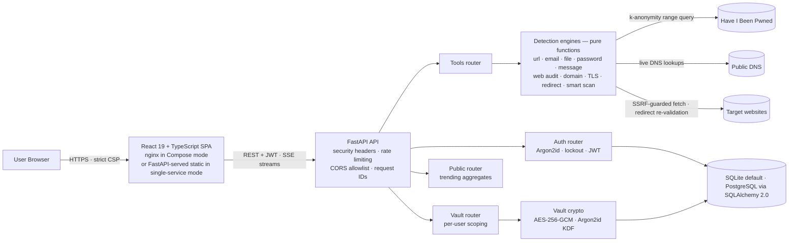

# 🛡️ Aegis — Personal Cyber Defense Platform

[](https://github.com/Manoj-2424150118/aegis-cyber-defense-platform/actions/workflows/ci.yml)
[](https://github.com/Manoj-2424150118/aegis-cyber-defense-platform/actions/workflows/codeql.yml)


[](https://aegis-cyber-defense-platform.onrender.com)

### ▶️ Live demo: [aegis-cyber-defense-platform.onrender.com](https://aegis-cyber-defense-platform.onrender.com) — no sign-up needed to check a link, email, file or password. *(Free-tier hosting: the first load after idle can take ~1 minute while the service wakes up.)*

[](https://render.com/deploy?repo=https://github.com/Manoj-2424150118/aegis-cyber-defense-platform) — one-click deploy of your own instance (free tier, uses this repo's `render.yaml` Blueprint).

**Repository:** [github.com/Manoj-2424150118/aegis-cyber-defense-platform](https://github.com/Manoj-2424150118/aegis-cyber-defense-platform)

---

## Overview

Most people are not compromised by nation-state zero-days. They are compromised by a phishing link in an SMS, a fake "verify your account" email, a malware attachment disguised as an invoice, a weak or reused password, secrets stored in plaintext notes, or card details typed into an unsafe website.

**Aegis is one platform that checks each of these *before* it hurts the user** — and practises what it preaches: the platform itself is hardened against the OWASP Top 10, with Argon2id authentication, an AES-256-GCM encrypted vault, SSRF-guarded fetching, rate limiting and strict security headers.

The homepage check is **Smart Scan** (v1.8.0): paste a link, a full email (headers and all) or a scam SMS/WhatsApp message, and Aegis detects the type, runs the matching engine and returns one verdict with explained findings — no tool-picking, no sign-up. Every analysis can also be watched live: findings stream stage-by-stage over Server-Sent Events in a terminal-style **Agent View**, and the streamed result is byte-for-byte the classic API result (parity is enforced by tests). Every finding in every report ships a concrete **Suggested fix**, written for the person holding the report.

Built by [Manoj Kumar Sharma](https://github.com/Manoj-2424150118) — Cybersecurity & Software Professional (MCA, Manipal University Jaipur).

---

## The nine protection tools

| # | Threat | Tool | What it detects / does |
|---|---|---|---|
| 1 | Phishing & fake login pages | **URL Analyser** | IP-literal hosts, punycode/homograph domains, typosquatting (edit-distance vs 22 brands incl. Indian banks & UPI), brand-in-host/path tricks, shorteners, `@` userinfo tricks, suspicious TLDs, DGA-like entropy, credential keywords — plus tracker detection with a cleaned link, and an SSRF-guarded redirect tracer |
| 2 | Phishing & Business Email Compromise | **Email Analyser** | SPF/DKIM/DMARC failures, Reply-To & Return-Path mismatches, display-name spoofing, freemail impersonation, urgency/pressure language, credential bait, link-text vs destination mismatch, tracking pixels and hidden text — and it re-scores every link with the URL Analyser |
| 3 | Malware & ransomware attachments | **File Scanner** | Magic-byte type spoofing, double extensions, dangerous types, Shannon entropy (packers), embedded droppers (PowerShell `-enc`, certutil, `curl \| sh`), macro auto-exec, base64-embedded PEs, zip bombs, executables hidden in archives. In-memory only — **files are never executed or written to disk** |
| 4 | Weak / reused / breached passwords | **Password Lab** | Entropy & offline crack-time estimate, common-password detection, a secure generator (`secrets` module) and diceware-style passphrases — plus a breach check via the Have-I-Been-Pwned **k-anonymity** range API: only 5 hex chars of the SHA-1 hash ever leave the machine, with an offline fallback list when the network is down |
| 5 | Theft of stored secrets | **Encrypted Vault** | **AES-256-GCM** authenticated encryption; the key is derived from the user's master password with **Argon2id**. The server stores ciphertext only — a database leak reveals nothing; tampering and wrong passwords are detected by the GCM tag |
| 6 | Scam SMS / WhatsApp messages | **Scam Message Checker** | Digital-arrest & agency impersonation, KYC/account-block threats, OTP/PIN harvesting, UPI payment redirection, Telegram task scams, prize/cashback bait, crypto-doubling — and it extracts and re-scores every link in the message |
| 7 | MITM & unsafe websites | **Website Audit** | Grades any site A–F on HTTPS/HSTS, CSP, X-Frame-Options, MIME-sniffing, Referrer/Permissions policy and cookie flags (Secure/HttpOnly/SameSite) |
| 8 | Domain spoofing | **Domain Security Checker** | Live DNS grading of any domain: A/AAAA liveness, MX, SPF (including invalid multiple records and `~all` softfail), DMARC policy strength (none → quarantine → reject) and CAA issuance control |
| 9 | Expired / mismatched certificates | **TLS Certificate Inspector** | Real TLS handshake: chain verification, hostname/SAN coverage (with wildcards), expiry runway, protocol version — with an unverified re-handshake to report broken certificates instead of hiding them |

**Smart Scan** (`POST /api/tools/smart-scan`) sits above all nine: it classifies pasted content and routes it to the right engine.

---

## Architecture



Design principles:

- **Pure, testable detection engines** — the modules take values and return values (no DB, no globals); the only network clients are the documented HIBP, DNS, TLS and guarded-fetch paths.
- **Explainability over black-box scoring** — every point in a risk score is a named finding with a human message and a suggested fix.
- **Zero-knowledge vault** — the master password never reaches the database; only `base64(salt ‖ nonce ‖ ciphertext)` is stored.
- **Defence in depth for the platform itself** — see the threat model below and [docs/ARCHITECTURE.md](docs/ARCHITECTURE.md).

---

## Threat model

| Assets | Adversaries | Mitigations |
|---|---|---|
| Vault secrets at rest | Attacker who obtains the database or a backup | AES-256-GCM authenticated encryption; key derived per item from the master password via Argon2id with a random salt; server stores ciphertext only |
| Account credentials & sessions | Credential stuffers, brute-forcers, token thieves | Argon2id password hashing; account lockout (5 failures → 15 min); stricter rate limits on `/api/auth`; short-lived access tokens; generic auth errors (no user enumeration); 12-character minimum passwords |
| Passwords submitted for breach checking | Network observers, the platform itself | HIBP k-anonymity — only the first 5 hex characters of the SHA-1 hash are transmitted; the full password/hash never leaves the client machine |
| Files submitted for scanning | Malicious uploaders, zip bombs, weaponised attachments | Static analysis in memory only — files are never executed or written to disk; 10 MB capped-chunk upload limit; archive expansion ratio/total caps; magic-byte vs extension checks |
| Platform availability & integrity | Abusive clients, fuzzers, injection attackers | Sliding-window rate limiting; Pydantic validation of every request body; SQLAlchemy parameterised queries; strict security-headers middleware + nginx CSP; global error handler returns generic errors with a request ID, never stack traces |
| Third-party systems reachable from the server | Users abusing the audit/tracer tools as an SSRF springboard | Fetcher resolves targets and refuses loopback/private/link-local/reserved addresses; every redirect hop is re-validated; only `http`/`https` schemes with timeouts — cloud metadata endpoints are unreachable through Aegis |
| Scan-history privacy | Other users, data aggregators | Vault and history rows are scoped per user on every query; the public trending endpoint exposes only privacy-safe aggregate counts, never submitted content |

Explicitly out of scope: endpoint compromise of the user's own device, and detection guarantees — static/heuristic analysis is a first line of defence, not a guarantee (see *Honest limitations*).

---

## Tech stack

| Layer | Technology |
|---|---|
| Backend | Python 3.12 · FastAPI 0.162 · Pydantic 2 · SQLAlchemy 2.0 |
| Frontend | React 19 · TypeScript · Vite 8 (served by nginx, or by FastAPI in single-service mode) |
| Authentication | Argon2id password hashing (`argon2-cffi`) · JWT (`PyJWT`) with lockout + rate limiting |
| Cryptography | AES-256-GCM vault encryption (`cryptography`) · Argon2id KDF · `secrets`-based password generation |
| Database | SQLite by default · PostgreSQL via `psycopg` 3 (set `AEGIS_DATABASE_URL`) |
| External services | Have-I-Been-Pwned range API (k-anonymity) · public DNS (`dnspython`) · live TLS handshakes |
| Deployment | Docker (multi-stage single-service image) · docker-compose (split frontend/backend) · Render Blueprint (`render.yaml`) |
| Quality & CI | GitHub Actions — ruff → bandit → pytest + coverage (backend), npm audit → `tsc` → vite build (frontend), docker compose build · CodeQL SAST · Dependabot |

---

## Setup & run

### Option A — Docker (recommended)

```bash
git clone https://github.com/Manoj-2424150118/aegis-cyber-defense-platform.git
cd aegis-cyber-defense-platform
docker compose up --build
```

- App: http://localhost:8080
- API docs (Swagger): http://localhost:8000/docs

### Option B — Local development

```bash
# Backend
cd backend
python -m venv .venv && source .venv/bin/activate   # Windows: .venv\Scripts\activate
pip install -r requirements-dev.txt
uvicorn app.main:app --reload --port 8000

# Frontend (new terminal)
cd frontend
npm install
npm run dev        # http://localhost:5173
```

### Configuration

All configuration comes from the environment (see `backend/.env.example`):

| Variable | Purpose |
|---|---|
| `AEGIS_SECRET_KEY` | JWT signing secret — **must** be overridden in production (a safe default exists only for local demos/tests) |
| `AEGIS_DATABASE_URL` | Optional PostgreSQL URL (e.g. a hosted Neon/Supabase instance) so accounts survive redeploys; unset = local SQLite |
| `AEGIS_TRUST_PROXY` | Set `true` only behind a proxy that sets `X-Forwarded-For` (the Render deployment does) |
| `AEGIS_ENVIRONMENT` | `production` for deployed instances |

### Try it in 30 seconds

```bash
curl -s -X POST localhost:8000/api/tools/url \
  -H 'Content-Type: application/json' \
  -d '{"url":"http://192.168.10.5/paypal/login/verify"}' | python -m json.tool
# → high risk score, verdict "malicious", with explained findings
```

---

## API reference (summary)

| Method | Endpoint | Auth | Purpose |
|---|---|---|---|
| POST | `/api/tools/smart-scan` | – | Paste anything — link, email or message; detects the type and runs the matching checker |
| POST | `/api/tools/url` | – | Phishing URL analysis + tracker detection & cleaned link |
| POST | `/api/tools/url/resolve` | – | Redirect-chain trace to the real destination (SSRF-guarded) |
| POST | `/api/tools/email` | – | Phishing email analysis + tracking-pixel & hidden-text detection |
| POST | `/api/tools/file` | – | Malware static scan (multipart, ≤ 10 MB) |
| POST | `/api/tools/password/assess` | – | Strength, entropy, crack-time estimate |
| POST | `/api/tools/password/breach` | – | k-anonymity breach lookup |
| POST | `/api/tools/password/generate` | – | Secure password + passphrase generation |
| POST | `/api/tools/web-audit` | – | Website security grade |
| POST | `/api/tools/message` | – | Scam SMS/WhatsApp message analysis |
| POST | `/api/tools/domain` | – | Domain SPF/DMARC/CAA security grade |
| POST | `/api/tools/tls` | – | TLS certificate inspection |
| GET | `/api/public/trending` | – | Scam trends from privacy-safe scan aggregates |
| POST | `/api/auth/register` · `/login` · `/refresh` | – | Argon2id + JWT auth with lockout |
| GET/POST/DELETE | `/api/vault` | JWT | Encrypted vault CRUD |

Every tool also has a `/stream` variant that returns the same result over Server-Sent Events for the live Agent View. Full interactive reference at `/docs` when the API is running.

---

## Testing & quality

```bash
cd backend && pytest -q --cov=app     # 161 tests: engines, crypto, API, lockout, headers,
                                       # streaming parity, remediation, validation,
                                       # trackers, redirect tracer, trends, smart scan
cd frontend && npm run build           # strict TypeScript + production build
```

CI runs on every push/PR: **ruff → bandit → pytest + coverage** (backend), **npm audit → tsc → vite build** (frontend), **docker compose build**, plus **CodeQL** SAST and weekly **Dependabot** updates.

The platform has also been through a dedicated hardening pass and an isolated-sandbox QA battery (`scripts/qa_battery.py`: functional checks, an attack suite — SSRF, SQLi, forged JWT, oversized uploads, brute force — 46 fuzz payloads, and a 100-request deterministic load loop). Findings were fixed and locked in as regression tests (`backend/tests/test_security.py`). Full results: [docs/QA_REPORT.md](docs/QA_REPORT.md).

---

## Project structure

```
├── backend/
│   ├── app/
│   │   ├── main.py            # FastAPI app, middleware stack, threat map
│   │   ├── config.py  db.py  models.py  security.py  deps.py
│   │   ├── headers.py         # security-headers middleware
│   │   ├── rate_limit.py      # sliding-window limiter
│   │   ├── modules/           # pure detection engines
│   │   │   ├── url_analyzer.py    email_analyzer.py   file_scanner.py
│   │   │   ├── password_lab.py    web_audit.py        vault.py
│   │   │   ├── message_analyzer.py  domain_checker.py  tls_inspector.py
│   │   │   ├── redirect_tracer.py   smart_scan.py      remediation.py
│   │   └── routers/           # auth.py · tools.py · vault_router.py
│   ├── tests/                 # 161 pytest tests
│   ├── Dockerfile · requirements*.txt · .env.example
├── frontend/                  # React 19 + TypeScript + Vite
│   ├── src/components/        # one component per protection tool
│   ├── Dockerfile · nginx.conf (CSP + header hardening)
├── docs/ARCHITECTURE.md       # architecture & STRIDE threat model
├── docs/QA_REPORT.md          # hardening & QA battery results
├── docker-compose.yml · Dockerfile · render.yaml
└── .github/                   # CI, CodeQL, Dependabot
```

---

## Security

**Please report vulnerabilities privately** — via GitHub Security Advisories ("Report a vulnerability" on the Security tab), not a public issue. The full policy, the platform's security design summary and its known limitations are in **[SECURITY.md](SECURITY.md)**.

In short: passwords are hashed with Argon2id; vault items are AES-256-GCM encrypted under an Argon2id-derived key and plaintext secrets are never stored; breach checks use k-anonymity so full passwords never leave the client; uploaded files are analysed in memory only and never executed or persisted; accounts lock after 5 failed logins and auth routes are rate-limited; every response carries a strict set of security headers and CORS is an explicit allowlist.

### Honest limitations

Static/heuristic analysis is a first line of defence, not a guarantee: novel malware can evade signatures, and legitimate marketing links can look suspicious. Aegis always *explains* its findings so the user can judge — and it complements, never replaces, an updated OS, browser and antivirus.

---

## Roadmap

- [ ] Browser extension that checks links in-page with the URL engine
- [ ] VirusTotal / URLhaus enrichment behind an optional API key
- [ ] Redis-backed rate limiting + PostgreSQL deployment profile
- [ ] YARA rule packs for the file scanner; sandbox detonation report export (PDF)
- [ ] Passkeys (WebAuthn) login; TOTP 2FA for the vault
- [ ] Hindi UI localisation for wider adoption in India

## Author

**Manoj Kumar Sharma** — Cybersecurity & Software Professional · Jaipur, India
MCA, Manipal University Jaipur · EC-Council Ethical Hacking Essentials · Google Cybersecurity Professional Certificate
Other work: [Deceptive-Net](https://github.com/Manoj-2424150118/Deceptive-Net-A-Honey-Token-Generative-Framework) (GAN honey-token defence) · [Portfolio](https://manoj-2424150118.github.io)

## License

MIT — see [LICENSE](LICENSE). Free for everyone: use it, fork it, modify it, self-host it. See also [CONTRIBUTING.md](CONTRIBUTING.md).
